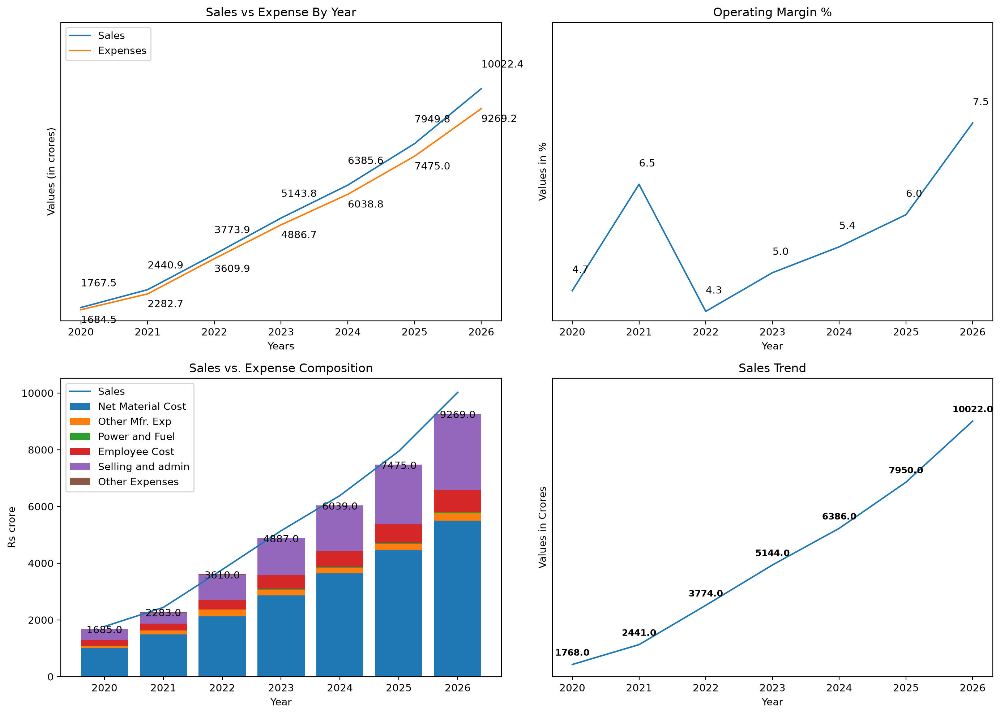
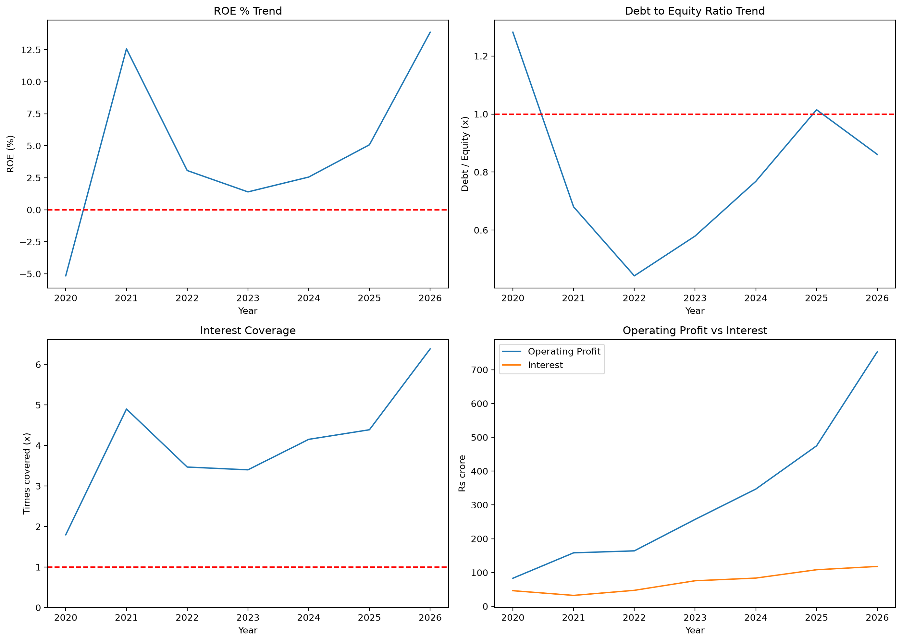
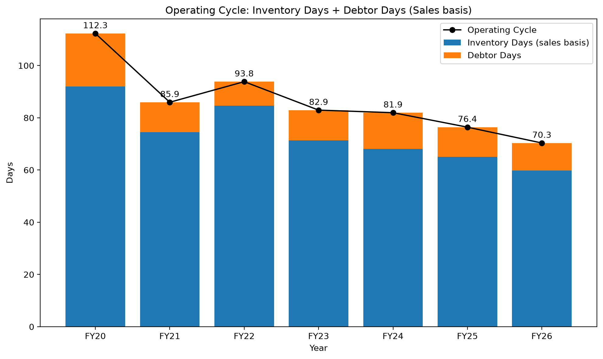
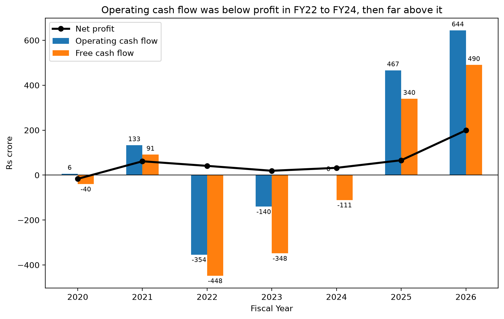
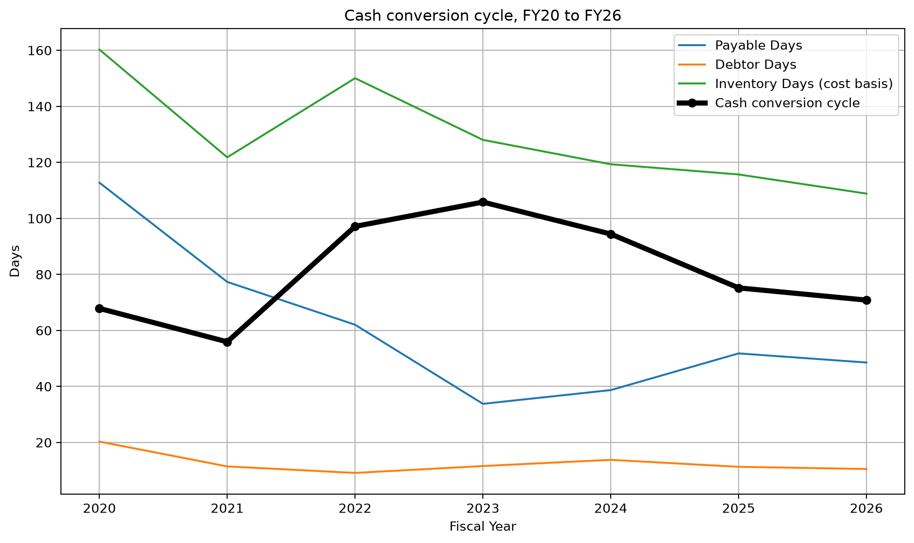

# Nykaa Financial Analysis Pipeline

I built this project to analyse Nykaa (FSN E-Commerce Ventures Ltd) from FY20 to FY26. I take the raw Screener.in files, clean them in Excel Power Query, store them in MySQL, and do the analysis in Python with pandas and matplotlib.

## Results at a glance

| Area | FY26 result | What it shows |
|---|---|---|
| Sales | Rs 10,022 cr (FY20: Rs 1,768 cr) | About 5.7 times bigger in six years |
| Operating margin | 7.5% (FY22 low: 4.3%) | Recovered after the FY22 dip |
| Net profit | Rs 199 cr (FY20: loss of Rs 17 cr) | Moved from loss to profit |
| ROE | 13.9% | Back up from 1.4% in FY23 |
| Debt-to-equity | 0.86 (0.52 without leases) | Screener's borrowings include leases |
| Interest coverage | 6.4x (FY20: 1.8x) | Operating profit grew faster than interest |
| Operating cash flow | Rs 644 cr | Was negative in FY22 and FY23 |
| Free cash flow | about Rs 490 cr | Negative from FY22 to FY24 |
| Cash conversion cycle | about 71 days (FY20: about 68) | Inventory and debtor days improved, payable days fell |
| DCF value per share | Rs 28.8 (range Rs 19 to Rs 41) | Against a market price of Rs 349.50, so my assumptions and the market are far apart |



## Why I built this

Most finance reporting I have seen depends on spreadsheets that people rebuild by hand every time. I wanted a flow I can repeat: clean the data once, store it in a database, and re-run the analysis when new numbers come in.

## How the pipeline works

```
Screener.in Excel export (wide format, many tabs)
   → Excel Power Query: remove junk rows and columns, unpivot the years, fix fiscal-year labels
   → CSV export: one file per statement
   → MySQL: six tables, each in Metric | Year | Value format (quarters also have Quarter)
   → Python (mysql-connector + pandas): pivot long to wide, join on Year, calculate ratios
   → matplotlib: multi-panel charts saved in the charts/ folder
```

The six MySQL tables are `incomestatement_annual`, `incomestatement_detailed` (the expense line items such as raw material, employee cost and selling and admin), `balancesheet_annual`, `cashflow_annual`, `quarters_annual` and `Working_capital_annual`.

I kept working capital (Debtors, Inventory, Working Capital) in its own table because Debtors and Inventory are already part of Other Assets in the balance sheet, and Working Capital is a derived number. Putting them together could double count. I also set a primary key on (Metric, Year) so that importing the same file twice gives an error instead of duplicate rows.

Indian financial years run April to March and are named by the year they end, so Mar-26 is FY26. All figures are in Rs crore and consolidated.

## Data quality checks

- Kept rupee values and ratios apart, so one column never mixes crores with percentages.
- Removed the "Total" rows after unpivoting, otherwise summing line items counts things twice.
- Changed Screener's quarter labels to fiscal year and quarter (Jun = Q1, Sep = Q2, Dec = Q3, Mar = Q4). Jun, Sep and Dec columns belong to the next fiscal year.
- Checked that total liabilities equal total assets in every year.
- Checked that operating + investing + financing cash flow equals net cash flow in every year (the biggest difference was 0.01).
- Compared my ROE, debtor days and inventory turnover with Screener's numbers. They matched, but Screener is also my source for the inputs, so this checks my calculation and not the source itself.
- Hand-calculated one year of every ratio. This caught a real mistake: my cost-basis inventory days came out near 30 instead of about 109, because I had used x100 instead of x365.
- Used DECIMAL(15,2) for money so there are no floating-point rounding problems.
- Ratios are calculated only in Python. I never write them back into MySQL.

## Ratios I calculated

- Profitability: net profit margin, operating margin, ROE
- Growth: YoY sales growth, YoY expense growth
- Cost structure: raw material, employee cost, selling and admin, interest and depreciation as % of sales
- Leverage and debt servicing: debt-to-equity, interest coverage
- Working capital: debtor days, inventory turnover, inventory days, operating cycle
- Cash flow: operating cash flow vs net profit, free cash flow, payable days, cash conversion cycle
- Valuation: a five-year forecast and DCF with a sensitivity table

## Key findings

- Sales grew from about 1,768 crore (FY20) to about 10,022 crore (FY26), and operating margin improved from 4.7% to 7.5%.
- The operating margin fell in FY22 (6.5% to 4.3%). Selling and admin went up from 15.9% to 23.5% of sales, and raw material cost went up from 62.8% to 66.0%. This was right after the IPO, so IPO-related spending could be the reason, but I have not confirmed it.
- ROE fell from 12.6% (FY21) to 3.1% (FY22) because the IPO money made equity about 2.7 times bigger while net profit dropped. It fell again to 1.4% in FY23 and then recovered to 13.9% in FY26, because net profit grew about ten times on a fairly stable equity base. FY20 ROE was about -5% because of a net loss.
- Debt-to-equity was about 1.28 in FY20, fell to 0.44 in FY22, went up to 1.01 in FY25 and came down to 0.86 in FY26. Screener's borrowings include lease liabilities. For FY26, borrowings of about Rs 747 cr plus leases of about Rs 491 cr give the 0.86. Without leases it would be about 0.52.
- Interest coverage improved from 1.8x (FY20) to 6.4x (FY26), because operating profit grew faster than interest cost.

## Charts

All charts are saved by the script in the `charts/` folder.

**Profit and loss:** sales vs expenses, operating margin, expense contribution to sales (stacked) and the sales trend.


**Balance sheet:** ROE, debt-to-equity, interest coverage, and operating profit vs interest.



Working capital, cash conversion cycle and cash flow charts are shown in their own sections below.

# Working Capital Analysis (FY20 to FY26)

Metrics I calculated (I used year-end balances for all of them, like Screener does; FY20 has no opening balance):

- Debtor Days = Debtors / Sales x 365
- Inventory Turnover = Sales / Inventory
- Inventory Days (Sales basis) = Inventory / Sales x 365
- Inventory Days (Cost basis) = Inventory / Net Material Cost x 365
- Operating Cycle (Sales basis) = Debtor Days + Inventory Days (Sales basis)

*Net Material Cost = Raw Material Cost - Change in Inventory. It is only a proxy for COGS, not a reported COGS figure.*



### Findings

- The operating cycle came down from 112 days to 70 days between FY20 and FY26. Around three quarters of this came from inventory days (92 to 60), and the rest from debtor days (20.3 to 10.5).
- Debtor days are low in every year (about 9 to 14 days after FY20). Collections did not get slower even though sales grew about 5.7 times. My guess is that most of Nykaa's online sales are prepaid or cash on delivery, but this is only a guesstimate.
- FY22 is the one year that went the other way. The operating cycle rose from 85.9 to 93.8 days. The whole increase came from inventory (74.5 to 84.7 days), because inventory went from Rs 498 cr to Rs 876 cr while sales grew about 55%. Debtor days actually fell that year. I think the company may have stocked up ahead of growth around the IPO period, but I have not confirmed this, so it stays a hypothesis.
- Inventory days on the cost basis are higher than on the Sales basis in every year (FY26: 108.9 vs 59.8), because Net Material Cost is only about 55% of Sales, so the denominator is smaller.

# Cash Flow and Earnings Quality (FY20 to FY26)

## Operating cash flow vs net profit

My first prediction was that operating cash flow (OCF) would be higher than net profit. It turned out to be higher in only 4 of the 7 years.

| FY | OCF (Rs cr) | Net profit (Rs cr) | OCF / Net profit | What I take from it |
|---|---|---|---|---|
| FY20 | 6.15 | -16.61 | -0.37x | Ratio means nothing (loss year), so I compare the rupees instead |
| FY21 | 133.18 | 61.55 | 2.16x | Can be used |
| FY22 | -353.96 | 41.08 | -8.62x | Only the sign matters: profit was positive but cash was negative |
| FY23 | -140.24 | 19.26 | -7.28x | Only the sign matters |
| FY24 | 0.25 | 32.27 | 0.01x | Profit gave almost no operating cash |
| FY25 | 466.63 | 66.08 | 7.06x | Only the direction, because the small profit makes the ratio look huge |
| FY26 | 644.30 | 199.44 | 3.23x | The most believable size, but it still needs an explanation |

This ratio breaks when profit is negative or very small, so in those years I look at the sign or the rupee amounts and not the size of the ratio.

## Free cash flow

Free cash flow = operating cash flow - capex. For capex I used the line "Fixed assets purchased" from Screener's expanded Cash from Investing section. I did not use the whole investing total. In FY22 the investing total was -603 but fixed assets purchased were only -94, because most of the rest went into other investments and subsidiaries. Capex is in whole rupees, so my free cash flow is approximate. I typed these values into the code by hand and noted the source.

| FY | FCF (Rs cr, approx.) |
|---|---|
| FY20 | -40 |
| FY21 | 91 |
| FY22 | -448 |
| FY23 | -348 |
| FY24 | -111 |
| FY25 | 340 |
| FY26 | 490 |

Free cash flow was negative from FY22 to FY24. I read this as a fast-growing company building up inventory and capacity with IPO money, not as a business in trouble.



The chart shows operating cash flow and free cash flow as bars with net profit as a line. FY24 operating cash flow was almost zero (0.25), so its bar is not visible.

## Payables and the cash conversion cycle

Screener has no trade payables line (it is hidden inside Other Liabilities, along with advances, provisions and lease liabilities), so I could not use it directly. I took consolidated trade payables by hand from the company's results filings, and from the October 2021 Red Herring Prospectus for FY20 and FY21. Each total is the sum of two reported lines (micro and small enterprises, and other creditors). Inventory and receivables in those filings matched my Screener data. The values are in a small DataFrame in my code, with the source written next to each year.

- Payable Days = Trade Payables / Net Material Cost x 365
- Cash Conversion Cycle = Inventory Days (Cost basis) + Debtor Days - Payable Days

| FY | Trade payables (Rs cr) | Payable days | Cash conversion cycle (days) |
|---|---|---|---|
| FY20 | 313.27 | 112.7 | 67.9 |
| FY21 | 316.21 | 77.3 | 55.9 |
| FY22 | 362.05 | 62.0 | 97.1 |
| FY23 | 265.39 | 33.8 | 105.8 |
| FY24 | 386.69 | 38.7 | 94.4 |
| FY25 | 634.83 | 51.8 | 75.2 |
| FY26 | 732.50 | 48.6 | 70.8 |

- From FY20 to FY26, inventory days got about 51 days better and debtor days about 10 days better. But payable days fell by about 64 days, so the cash conversion cycle ended almost where it started (about 68 to about 71 days). It was highest in FY23 at about 106 days.
- I do not know why payable days fell. That is still a hypothesis.
- Payables also include suppliers other than stock suppliers (marketing, for example), while my base is only net material cost, so these days are approximate. This cycle is also a different measure from the sales-basis operating cycle above.



## Why OCF is different from net profit

Gap = OCF - net profit. I split the gap into working capital changes (estimated from year-end balance sheet differences), depreciation (a cost that uses no cash), and whatever is left unexplained. When an asset like inventory or debtors goes up, it uses cash. When a liability like payables goes up, it releases cash.

| FY | Gap | Inventory, debtors and payables | Depreciation | Unexplained |
|---|---|---|---|---|
| FY21 | 71.63 | -28.02 | 71.59 | 28.06 |
| FY22 | -395.04 | -349.58 | 96.41 | -141.87 |
| FY23 | -159.50 | -295.18 | 173.26 | -37.58 |
| FY24 | -32.02 | -143.68 | 224.23 | -112.57 |
| FY25 | 400.55 | 17.64 | 266.40 | 116.51 |
| FY26 | 444.86 | -169.72 | 320.33 | 294.25 |

- OCF was lower than profit in FY22, FY23 and FY24, and negative in FY22 and FY23. The inventory build is the main thing I could measure (FY22 inventory went up by about Rs 378 cr), but it only explains part of the gap, and it is an estimate.
- In FY23, payables also fell by about Rs 97 cr, so Nykaa paid its suppliers down and that used more cash.
- In FY25, payables went up by about Rs 248 cr. That explains about two thirds of what was unexplained before, and about Rs 117 cr is left. In FY26 about Rs 294 cr is still unexplained.
- Things I have **not** tested, so they are only hypotheses: employee stock option expense (a non-cash cost), other current assets and liabilities, tax paid, and whether interest paid is shown under financing instead of operating activities.
- My working capital figures come from balance sheet differences, not from the cash flow statement's own lines, so the whole bridge is an estimate.

# DCF Valuation

I built a simple five-year DCF (FY27 to FY31) in pandas, step by step, and checked each step by hand for FY27. It is a model of my own assumptions, so I treat the result as something to question and not as a price target.

## How it works

```
Forecast sales for FY27 to FY31 (last year's sales x (1 + growth))
   → Operating profit = sales x margin
   → EBIT = operating profit - depreciation
   → NOPAT = EBIT x (1 - tax)
   → FCFF = NOPAT + depreciation - capex - increase in working capital
   → Discount each year's FCFF back to today at 12%
   → Add a terminal value (cash flows after FY31 growing at 5% for ever), also discounted
   → Enterprise value - net debt = equity value, divided by shares = value per share
```

FCFF means free cash flow to the firm: the cash left after operating costs, tax (as if there were no debt), capex and extra working capital, before paying lenders and shareholders.

## My assumptions

All of these are assumptions, not facts. I tied the first two to the trend in my own data.

| Input | What I used | Why |
|---|---|---|
| Sales growth FY27 to FY31 | 22%, 19%, 16%, 13%, 10% | Growth settled at about 24% to 26% in FY24 to FY26, so I started a little lower and faded it |
| Operating margin | 8.0% rising to 10.0% | It rose from 5.0% (FY23) to 7.5% (FY26), so I continued the trend more slowly |
| Depreciation | 3.2% of sales | FY26 share of sales (320.33 / 10,022.35) |
| Capex | Starts at 1.5% of sales and rises to 3.2% by FY31 | Starts at the FY26 level and ends equal to depreciation, so the terminal year does not add back depreciation that is never reinvested |
| Working capital | 12.0% of the increase in sales | FY26 inventory + debtors - trade payables, as a share of sales |
| Tax | 25% | Close to the standard Indian corporate rate including surcharge and cess |
| Discount rate | 12% | A judgement |
| Terminal growth | 5% | A judgement |

## Results

| FY | Sales (Rs cr) | FCFF (Rs cr) |
|---|---|---|
| FY27 | 12,227 | 339 |
| FY28 | 14,550 | 446 |
| FY29 | 16,879 | 568 |
| FY30 | 19,073 | 703 |
| FY31 | 20,980 | 842 |

- Enterprise value is about Rs 9,158 cr. About 78% of it comes from the terminal value, so the answer depends mostly on the assumptions and not on the five forecast years.
- Net debt is Rs 917.8 cr: borrowings including lease liabilities (1,237.8) minus cash and bank balances (320.0), from the FY26 results filing.
- Equity value is about Rs 8,240 cr, which is about **Rs 28.8 per share** on 286.43 crore shares.
- The share price was Rs 349.50 (NSE, 2 November 2026), so my value is about 92% below it.

### Sensitivity: value per share (Rs) at different discount and terminal growth rates

| Discount rate | Growth 4% | Growth 5% | Growth 6% |
|---|---|---|---|
| 11% | 29.9 | 34.5 | 40.9 |
| 12% | 25.4 | 28.8 | 33.2 |
| 13% | 22.0 | 24.5 | 27.7 |
| 14% | 19.2 | 21.2 | 23.6 |

## What I take from it

- The value is very sensitive: it ranges from about Rs 19 to Rs 41 with small changes to two assumptions, so I would never trust one single number from this model.
- Every cell is far below the market price. So the gap is not about the discount rate. It comes from what I assumed for growth and margins, or from something the market is pricing that a five-year model cannot capture. I have not tested which, so that is a hypothesis.
- This is not investment advice, and I am not giving a price target.

## Simplifications in my model

- Depreciation is a fixed share of sales, which is easy to explain but not how depreciation really works.
- Net debt includes lease liabilities, to match Screener's borrowings and the depreciation add-back. I ignored a small non-controlling interest (about Rs 64 cr) and very small investments.
- Other income is not in the forecast, and only the FY26 balance sheet and a share price of one date are used. The share price changes daily, and new quarterly results can change the picture.

## Status and next steps

Done: the data pipeline (six tables), P&L, balance sheet and quarterly tables, ratio analysis, working capital, cash flow and earnings quality, free cash flow, payables and cash conversion cycle, DCF with a sensitivity table, the charts above, and a cleaned-up script with comments and the database password kept in a `.env` file.

Next: quarterly analysis (seasonality and growth), common-size statements, a DuPont breakdown of ROE, a peer comparison, and maybe AI-written commentary based on the ratio tables.

## How to run it

1. Load the CSV files into a local MySQL database called `nykaa_analysis` (the tables are listed above).
2. Install the packages: `pip install -r requirements.txt`
3. Copy `.env.example` to `.env` and write your MySQL password in it (`DB_PASSWORD=...`). The `.env` file is not uploaded to GitHub.
4. Run `python app.py`. It prints the DCF sensitivity table, net debt and value per share, and saves the charts in `charts/`.

## Data source

Financial statements from Screener.in (public company data). Consolidated trade payables, cash and bank balances come from FSN E-Commerce Ventures' published results filings and its October 2021 Red Herring Prospectus. Share price and share count come from public market data pages. This analysis is for learning and my portfolio, and it is not investment advice.

## Tech stack

Excel Power Query, MySQL, Python (pandas, matplotlib, mysql-connector-python, python-dotenv)